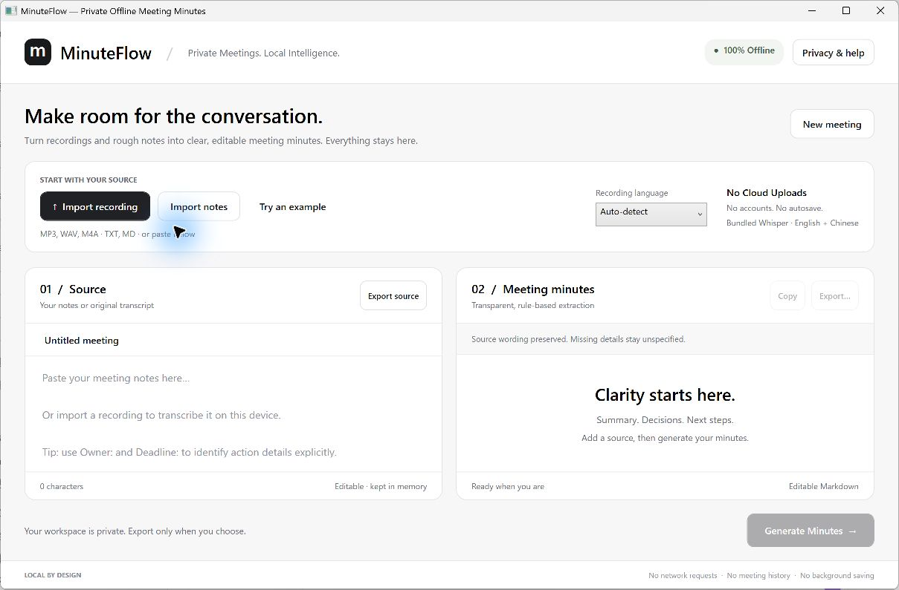
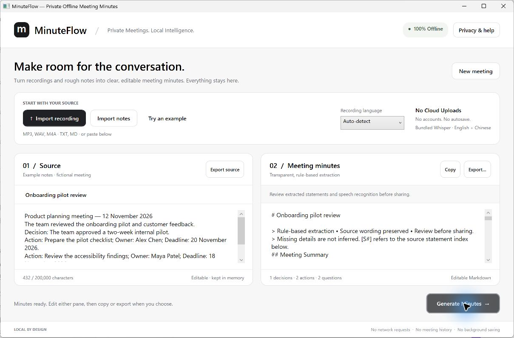

# MinuteFlow — Private Offline Meeting Minutes

**Private Meetings. Local Intelligence.**

A portable Windows application for confidential meeting recordings and notes. English and Chinese speech recognition runs locally using bundled Whisper. Minutes use transparent, conservative rules rather than a generative summarization model.

## Open the application

1. Extract **MinuteFlow-Windows-x64.zip** into a regular local folder, outside cloud-sync folders.
2. Open the extracted **MinuteFlow** folder.
3. Double-click **MinuteFlow.exe**. Keep its accompanying files and folders together.
4. The two-pane workspace opens. **Success:** “100% Offline” and “No Cloud Uploads” appear, with no login, download, terminal, or server setup.

You can disconnect the internet before the first launch. The app includes its .NET runtime, Whisper engine, speech model, and audio integration. This development build is unsigned; organizational application-control policies may require approval from your administrator. No installation or administrator privileges are required by MinuteFlow itself.

**Supported target:** Windows 11 x64, a CPU with AVX2/FMA support, and standard Windows media components. Recommended: 8 GB RAM, at least 1 GB free disk space. Windows N editions need their Media Feature Pack already installed. Windows 10 and ARM64 have not been validated. No GPU required.

## Try it in one minute

1. Click **Try an example**. **Success:** fictional meeting notes appear on the left.
2. Click **Generate Minutes**. **Success:** the right pane contains the five requested sections, plus source references.
3. Edit either pane. If you change the source, regenerate to update the minutes. **Success:** a “Source changed” notice appears until regeneration.
4. Choose **Copy** or **Export…**. Select Markdown or plain text. **Success:** the status confirms copying or exporting.
5. Use **Export source** separately if you want to preserve the transcript.

## Use your own recordings or notes

1. Choose **Import recording** for MP3, WAV, or AAC M4A. Select **English**, **Chinese**, or **Auto-detect** before importing. You can also drop one file onto the window.
2. Wait for local transcription. CPU use will rise during processing; long meetings can take several minutes or longer. Use **Cancel** to stop. **Success:** the transcript appears on the left with a completion notice.
3. Read the transcript and correct names, dates, unclear speech, and omissions. Whisper can misrecognize speech and sometimes produce words that were not spoken. It does not identify speakers. Chinese output may be Simplified or Traditional Chinese.
4. Alternatively, select **Import notes** for TXT/MD, or paste directly in the left editor. UTF-8 and BOM-marked UTF-16 are supported.
5. Enter a meeting title and select **Generate Minutes**. Review, edit, and export.

Limits: one file at a time; audio up to 500 MB and 2 hours, mono/stereo; notes up to 1 MB and 200,000 characters. DRM-protected, unusual codec, or multichannel audio may be rejected. The application preserves your existing workspace if import, transcription, or cancellation fails.

## How the minutes are made

This is **rule-based extraction**, not AI-generated summarization:

- **Meeting Summary:** the first five non-question source statements, quoted as excerpts. This is not a complete semantic summary of a long meeting.
- **Key Decisions:** statements with explicit decision wording, excluding common negative, tentative, and conditional phrases.
- **Action Items:** statements with action labels or explicit responsibility/future-action wording.
- **Responsible Persons & Deadlines:** values copied from explicit fields or narrowly recognized wording. Relative dates remain relative. Pronouns are not resolved into identities. Unrecognized/missing values say “Not specified (check source wording).”
- **Open Questions:** explicit questions and recognized unresolved statements.
- **Source Reference:** every original statement is retained in a numbered snapshot, even if it was not classified. `[S4]` links a result to statement 4 in that snapshot. Rebuild the snapshot by regenerating after source edits.

Rules cover common English and Simplified/Traditional Chinese patterns. They can miss or misclassify statements; they do not interpret every conversational nuance. Excerpts keep source wording rather than inventing facts. For reliable action details, write:

```text
Decision: Run an internal pilot.
Action: Prepare the checklist; Owner: Alex Chen; Deadline: 20 November 2026.
Open question: Who will own customer training?
```

Regeneration replaces edits in the minutes pane after confirmation. The source pane remains editable. A new meeting clears editor undo history to avoid bringing back the previous meeting accidentally.

## Privacy

MinuteFlow has no account system, cloud endpoint, analytics, telemetry, model downloader, embedded browser, local web server, or updater. It makes no application network requests. No meeting content is automatically saved. Audio is decoded and processed in memory; no sensitive conversion files are created. Workspace contents are discarded on close.

**Copy and Export are deliberate disclosures to your own computer:** copied text can be read by other local apps; exported files remain on disk. Clipboard history/cloud flags are disabled for the Copy button. Export outside OneDrive/Dropbox or other sync folders. The app rejects network paths, mapped network drives, and filesystem reparse paths, but cannot detect every third-party synchronization configuration.

Windows may page memory, create crash dumps, or index/export files. Other installed software may capture content. MinuteFlow does not promise secure RAM erasure or control operating-system behavior. See [PRIVACY.md](PRIVACY.md).

## Troubleshooting

- **Model missing:** extract the complete ZIP again. `models/ggml-base.bin` must remain with the app. The app will never attempt a download.
- **Cannot open audio:** try a standard mono/stereo PCM WAV or AAC M4A. Check the file is local, readable, unprotected, and within the limits.
- **Poor transcript:** select the language explicitly, improve recording quality, and correct the transcript before generating minutes.
- **No owners/deadlines:** use the explicit `Owner:` and `Deadline:` fields shown above. Never assume a name or date that was not recorded.
- **Clipboard busy:** try Copy again or use Export.
- **Nothing retained after closing:** this is intentional. Export before closing.

All MinuteFlow-authored interface text is English; Windows-provided file pickers, window menus, and standard dialog buttons follow your Windows display language.

## Screenshots and verification

See [docs/TEST-REPORT.md](docs/TEST-REPORT.md) for the actual test environment, checks, and limitations.





## Developer build

End users do not need these steps. The source uses C#/.NET 10 WPF, Whisper.net 1.8.1 (whisper.cpp), and NAudio 2.2.1. Windows Media Foundation handles installed media codecs. Dependencies are pinned in `src/MinuteFlow.csproj`.

1. On a Windows development machine, install .NET 10 SDK. Build-time package/model downloads require internet; the delivered app does not.
2. Place the multilingual `ggml-base.bin` model in `models/` from the [official model repository](https://huggingface.co/ggerganov/whisper.cpp).
3. Verify SHA-256: `60ed5bc3dd14eea856493d334349b405782ddcaf0028d4b5df4088345fba2efe` (147,951,465 bytes).
4. Run `./build.ps1 -Restore` once. Later builds use `./build.ps1` without network access. The script copies the app-local VC runtime from this build machine; use appropriately licensed Microsoft redistributable files on other build machines.
5. **Success:** `artifacts/MinuteFlow/MinuteFlow.exe` launches independently of an installed .NET SDK/runtime.
6. Run `tests/run-tests.ps1` for the diagnostic suite. Optional local speech fixtures can be generated by `tests/make-fixtures.ps1` when the named Windows voices are installed. Use `tests/run-tests.ps1 -Speech` for all six audio/language combinations.

See [THIRD-PARTY-NOTICES.md](THIRD-PARTY-NOTICES.md) for component origins and licenses. This project has not been uploaded to AgentGit.
